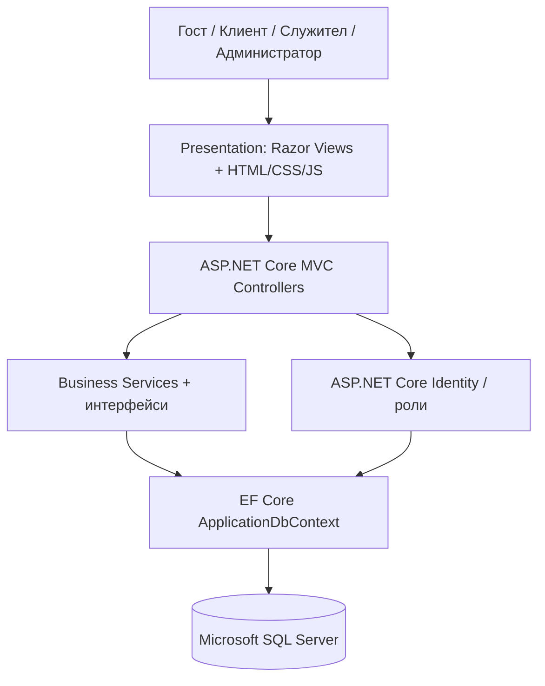

# Архитектура на системата

## Многослойна архитектура

**Presentation layer:** Razor Views, навигация, клиентска валидация и responsive CSS.  
**Controller layer:** валидира входа, управлява HTTP отговорите, делегира към услугите.  
**Business layer:** каталог, изчисляване на цена за наем, планирани поръчки и проверки за наличност.  
**Data layer:** EF Core DbContext и SQL Server.  
**Identity:** потребители и роли, Claims/Authorize.

### Компоненти в началния проект

| Компонент | Отговорност | Ниво на реализация |
|---|---|---|
| HomeController | Начало, грешки | Начално работещ |
| BicyclesController | Каталог + детайли | Начално работещ |
| RentalsController | Списък за наем | Начално работещ; резервация предстои |
| OrdersController | Преглед на поръчки с филтър по собственик | Начално работещ; покупка предстои |
| AdminController | Защитена статистика | Начално работещ; CRUD предстои |
| BicycleCatalogService | Търсене/детайли/отдаване | Реализиран |
| RentalPricingService | Пресмятане цена за дати | Реализиран + тестове |
| ApplicationDbContext | ORM и релации | Реализиран модел |
| DbSeeder | Примерни записи и роли | Реализиран; работи след създаване на БД |

## Комуникация и HTTP

- Browser → GET `/Bicycles?search=...` → BicyclesController → BicycleCatalogService → EF Core → SQL Server → Razor HTML.
- Browser → GET `/Bicycles/Details/1` → BicyclesController → Service → View или 404.
- Browser → GET `/Admin` → ASP.NET Core Authorization проверява дали ролята е Admin/Employee → данни от SQL Server или HTTP 403/redirect.
- Следващ етап: POST от покупка или резервация → server validation → бизнес услуга → транзакция и запис → confirmation.

## Модел на отговорности

Контролерите не трябва да съдържат SQL и сложни бизнес правила. Услугите се инжектират през Dependency Injection. EF Core осъществява работата с данни и промени. Предвижда се използването на **Strategy design pattern** за различни тарифи за наем (стандартен/дългосрочен); в Етап 1 е реализиран един калкулатор, не пълно семейство стратегии.

## План за сигурност

1. Регистрация/вход чрез ASP.NET Core Identity, което пази паролите като хешове.
2. Роли `Client`, `Employee`, `Admin`; `[Authorize]` на защитените контролери.
3. Достъпът до поръчки на клиент се филтрира по неговия `ApplicationUserId` на сървъра.
4. Данни на администратора: User Secrets/променливи на средата, никога в Git.
5. На следващ етап: бизнес проверки срещу двойно резервиране, DB транзакции при заявка, 403/404 страници, логове без лични данни, ограничения за вход и rate limiting.
