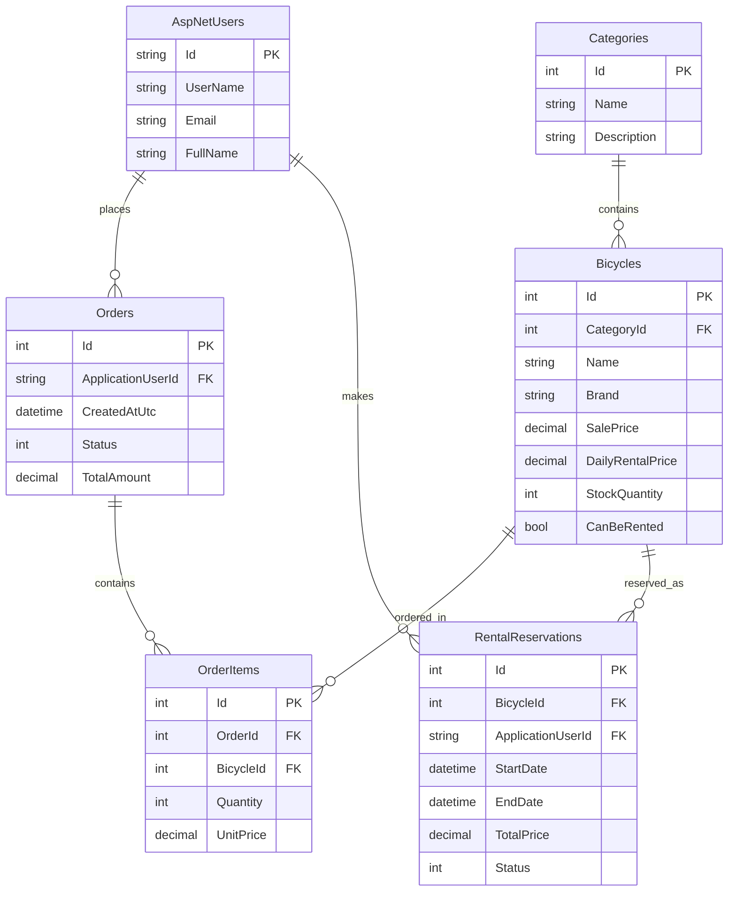

# Проектиране на началната база данни

**СУБД:** Microsoft SQL Server. **Достъп:** Entity Framework Core Code First.  
**База:** `BikeStoreDb`.

## ER диаграма (областни таблици)



## Таблици

1. **Categories:** `Id (PK)`, `Name (unique)`, `Description` – категории велосипеди.
2. **Bicycles:** `Id (PK)`, `CategoryId (FK)`, `Name`, `Brand`, `Description`, `SalePrice`, `DailyRentalPrice`, `StockQuantity`, `CanBeRented`, `ImageUrl`.
3. **Orders:** `Id (PK)`, `ApplicationUserId (FK)`, `CreatedAtUtc`, `Status`, `TotalAmount`.
4. **OrderItems:** `Id (PK)`, `OrderId (FK)`, `BicycleId (FK)`, `Quantity`, `UnitPrice` – редове към поръчки.
5. **RentalReservations:** `Id (PK)`, `BicycleId (FK)`, `ApplicationUserId (FK)`, `StartDate`, `EndDate`, `TotalPrice`, `Status`.
6. **AspNetUsers + Identity таблици:** потребители, роли, потребителски роли, логини, токени и claims.

Така са налице **поне 5 бизнес entities**, плюс identity потребител.

## Ограничения и целостта на данните

- Положителни цени и неотрицателна складова наличност.
- Край на наемния период след начало (`EndDate > StartDate`).
- Външни ключове с `Restrict` за запазване на историята на покупки/наеми.
- `OrderItem.Quantity > 0` на ниво валидиране; допълнителни SQL CHECK ограничения са планирани.
- Индекс за `Category.Name`, индекс за `(Bicycle.CategoryId, Bicycle.Name)` и за `(RentalReservation.BicycleId, StartDate, EndDate)`.
- **Важно:** ограничението за период само по себе си **не предотвратява застъпващи се резервации**. Това ще бъде бизнес правило в сървърна транзакция с проверка спрямо брой налични велосипеди.
- Пароли **не** се съхраняват в самостоятелна таблица или като plaintext – използва се Identity.

## Начално създаване

Препоръчително: в Package Manager Console при първо стартиране:

```powershell
Add-Migration InitialCreate
Update-Database
```

Или алтернативно изпълнете `database/01_initial_schema.sql` в SSMS **върху нова база**. Не смесвайте двата метода за един и същ каталог, защото EF миграционната история на SQL скрипта не е създадена.

**Състояние:** Дефинирани са класовете, връзките, ограниченията и SQL скриптът. Създаването на физическата база на потребителския компютър и screenshot от SSMS изискват локално изпълнение.
